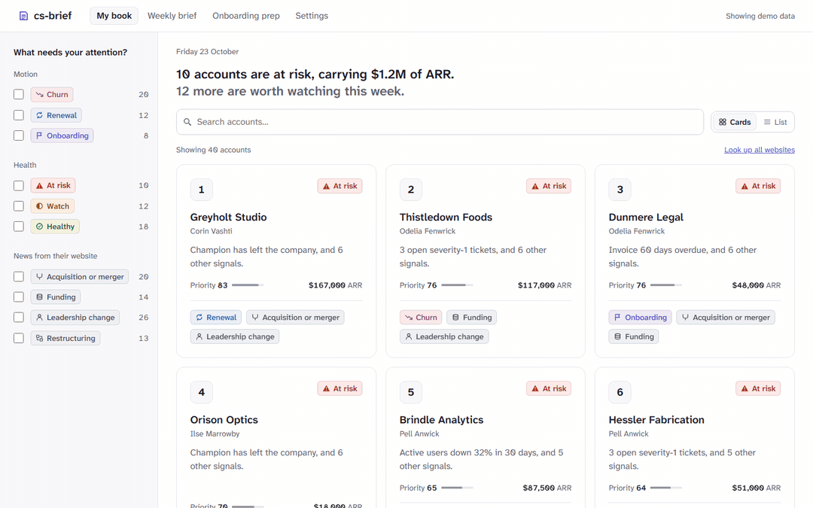

# Wardmind

Rank a Customer Success book of business and explain, in plain English, why each account needs
attention this week. It is reachable three ways, all backed by the same core code:



- **Web dashboard:** `wardmind ui` opens a local page at http://127.0.0.1:8000 with:
  - **Today:** follow-ups due, threads waiting on a reply, accounts that need attention, and
    renewals to record, with a find box
  - **My book:** the ranked list with each client's logo, what changed since last week, and a
    sort by room to grow
  - **Account pages:** the score breakdown, signal history and next step; an activity history
    (calls, meetings and emails, logged automatically once you connect a mailbox), notes, pins,
    the account team, and room to grow
  - **Renewals:** call each upcoming renewal Commit, Likely or At risk, see the ARR behind each
    call and where Wardmind disagrees, and later how your calls held up. Each renewal has a
    one-page negotiation sheet: strengths, exposures and what the client may ask for.
  - **Weekly brief:** a one-page summary with **Print or save as PDF** (fits on 2 A4 pages)
  - **Onboarding prep:** pick an account to get a call brief. It covers where the account is on
    the standard onboarding plan, an agenda, questions to ask and the signals to watch. You can
    print it (1 page) or copy it as text.
  - **Settings:**
    - Appearance: theme, accent colour, density, and which screen it opens on. These are saved
      to `config/settings.yaml`.
    - Scoring: sliders for every weight and threshold, with a live preview of how your top 10
      would reorder. These are saved to `config/scoring.yaml`.
    - Connections: demo data or your data, HubSpot, spreadsheets and accounts added by hand.
    - Mailbox: log client emails into each account's activity history, read-only, with an app
      password.
    - Data & privacy: web research and AI summaries on or off, your OpenRouter key, and
      clearing the local cache.
- **Desktop app:** `Wardmind.exe` (or `wardmind desktop`) shows the same dashboard in its own
  window on Windows
- **Claude (MCP):** `wardmind mcp` serves the book to Claude over stdio
- **Terminal:** `wardmind score` prints the top of the book

It runs on bundled demo data (40 invented accounts), or on **your data**, which can mix these
connections:
- **HubSpot:** read-only; see [docs/hubspot.md](docs/hubspot.md) for setup
- **Spreadsheets:**
  - import a CSV or Excel file, or paste cells copied from Excel or Google Sheets
  - columns are matched for you, and only name, ARR and renewal date are required
  - import again whenever the sheet changes, and the signal history builds up
- **Accounts added by hand**

You can edit any account. An edit to a value that came from a connection lasts until that
connection changes the value; then the new value wins and the account page tells you. When the
same customer turns up in two connections, Wardmind suggests linking them, and you confirm.
Everything you add or change is stored in your user profile (`%LOCALAPPDATA%\wardmind\data`),
not in this folder.

## Desktop app (Windows)

**Wardmind.exe** opens the dashboard in its own window, with no browser tab and no terminal.
Closing the window stops Wardmind and its background data feed syncs.

- **Get it:** build it with `.\packaging\build.ps1` (see below). Then double-click
  `Wardmind\Wardmind.exe`, or copy the zip to another Windows 10 or 11 computer and unzip it
  anywhere. Nothing needs installing; the window uses Microsoft Edge WebView2, which is part
  of Windows.
- **First run:** the app isn't code-signed, so Windows SmartScreen may say "Windows protected
  your PC". Choose **More info > Run anyway**.
- **Settings:** the desktop app keeps appearance and scoring settings in
  `%LOCALAPPDATA%\wardmind\config`, beside your data, rather than in a `config` folder.
- **Claude:** the same folder has `wardmind-cli.exe` for the MCP server:

  ```powershell
  claude mcp add wardmind -- "<path to the Wardmind folder>\wardmind-cli.exe" mcp
  ```

- **Links** to other websites (a customer's news, OpenRouter) open in your normal browser.
- Only one Wardmind window can be open at a time.

To build it (from this folder, after `uv` is installed):

```powershell
.\packaging\build.ps1
```

It writes `Wardmind\` and `Wardmind-<version>-windows-x64.zip` to `Wardmind-build` in your
user folder. From source, `uv run wardmind desktop` opens the same window.

## Quickstart (Windows, PowerShell)

Requires Python 3.11+ and [uv](https://docs.astral.sh/uv/).

```powershell
. .\scripts\dev.ps1        # keeps the virtualenv outside OneDrive
uv sync
uv run wardmind score      # ranked top 10 in the terminal
uv run wardmind ui         # dashboard at http://127.0.0.1:8000, opened in your browser
uv run wardmind open       # open the running dashboard in another browser window
```

### Use it from Claude Code

```powershell
claude mcp add wardmind -- uv --directory "<path to this folder>" run wardmind mcp
```

The server exposes seven tools:

| Tool | What it returns |
|---|---|
| `list_book` | accounts in priority order; optional `motion`, `search`, `limit` |
| `get_account` | everything about one account, including your journal (dates, follow-ups and outcomes; never note text) |
| `explain_score` | why the account ranks where it does, with a short summary |
| `weekly_brief` | totals, counts by health and motion, call-outs, the top accounts, and what changed since last week |
| `todays_list` | your follow-ups due, accounts that need attention, renewals to record |
| `onboarding_brief` | a prep brief for an onboarding call: plan status, agenda, questions |
| `research_account` | what the customer's own website says: title, description, recent news (only when web research is on) |

## Data feeds: keep your data up to date by itself

**Settings > Connections > Add a connection** opens a catalog of sources. Each one either adds
accounts (an automatic spreadsheet import) or adds signals to accounts you already have,
matched by ID, website or name:

| Source | What it brings in |
|---|---|
| File on this computer, Link to a file, Google Sheets | Any CSV, TSV, Excel or JSON export, re-read when it changes or on a schedule |
| Any JSON API | Records from an API, following its next-page links |
| SQLite database | The result of your own read-only `SELECT` query |
| Stripe, Chargebee | Days each customer's oldest unpaid invoice is overdue |
| Zendesk, Freshdesk | Open urgent tickets per customer |
| PostHog | Usage trend and days since last login per company, or your own HogQL query |
| Airtable | Any table, as accounts or as signals |

You match the source's columns once, see what will happen before saving, and then the feed syncs
on its schedule. Settings > Connections shows when each feed last synced, any problem, and rows
that didn't match an account. Feeds only read, and each feed's key is sent only to its own
source ([PRIVACY.md](PRIVACY.md#data-feeds-in-detail)).

## Today, notes and follow-ups

Wardmind tells you which accounts need attention. The journal is where you record what you did
about them:

- **Notes and touches:** on each account page, add a dated note, or log a call, meeting or
  email. The account then shows when you last contacted it.
- **Follow-ups:** "do this by <date>", one click from the suggested next step. Mark them done
  (with Undo), move them, or remove them.
- **Snooze:** "I've dealt with this, leave it off Today for 7 days". A snooze ends by itself,
  or sooner if the account's health gets worse.
- **Renewal outcomes:** once a renewal date passes, record how it went: renewed, expanded,
  contracted or churned. Wardmind keeps what it thought of the account at that moment, so the
  scoring can learn from real outcomes later.
- **Today** (first in the top bar, with a count of what's due) lists:
  - follow-ups due today or late
  - at-risk and watch accounts you haven't touched in 14 days
  - renewals waiting for their outcome
  - what's coming up this week, and what's snoozed

You can also make Today the screen Wardmind opens on (Settings > Appearance).

## Score history: what changed since last week

With your data, Wardmind keeps one score snapshot a day: every account's rank, risk, health and
signal values. It takes one when you open My book, and every hour while Wardmind is open.
- **My book** and the **Weekly brief** say what changed since last week: accounts that got worse
  or better, rising risk, and accounts that joined or left your book.
- Each **account page** shows its risk over the last 90 days.

History starts the day you first use this version, so the weekly comparison appears a week
later. With demo data, the history is worked out from the sample readings, so you can see it
straight away.

## Contacts and client updates

Each account page has a **Contacts** list: who's who at the customer, who the main contact is,
and who has left. When the last main contact leaves, the **Champion left** risk signal is set
automatically, and adding a new main contact clears it.

**Client updates** (optional, per client) let customers tell you themselves when someone joins
or leaves:
1. Make one form for all your clients (Microsoft Forms, Airtable or Google Forms).
   **Client updates > Set up your update form** lists the questions to add.
2. Connect its responses as a data feed, and paste the form's pre-filled link.
3. On each account whose client agreed, turn on **Client updates** and send them their own
   link. It already has their client code in it, so they have nothing to log in to.
4. New responses appear on the **Client updates** page, with a count in the top bar. Accept
   them (correcting anything first) or reject them. Nothing changes until you accept.

## Web research (optional, off by default)

Turn it on in **Settings > Data & privacy**. Each account page then gets a **Look up their
website** button. It visits that customer's own website (the account's Website field) and shows:
- the site's title and description
- the latest posts from the news or blog feed it publishes, tagged when they mention funding,
  an acquisition, a leadership change or restructuring

No search engine is involved, and nothing about the account is sent. Results are kept on your
computer for 24 hours. With demo data, you see invented sample news and nothing is sent.

**Look up all websites** does the whole book at once (8 sites at a time, with a progress bar),
and My book then shows each account's news topics next to its name.

**AI summaries** (also optional and off by default) use your own
[OpenRouter](https://openrouter.ai) key to turn each website into a short About and up to three
highlights. The default model is `anthropic/claude-haiku-5.5`, and you can pick any OpenRouter
model. Only the website text is sent, never anything from your book, and each summary is reused
until the website changes, so a book of 40 accounts typically costs a cent or two.

[PRIVACY.md](PRIVACY.md) has the details.

## How scoring works

Eight signals add risk points: usage trend, days since login, open severity-1 tickets, NPS,
champion left, seat utilisation, overdue billing and overdue onboarding milestones.

- **Risk:** each signal has a `start` value, where its risk begins, and a `full` value, where it
  adds its whole weight. Risk is the total of all signals, capped at 100.
- **Health:** risk of 45 or more is **At risk**, 20 or more is **Watch**, and anything lower is
  **Healthy**.
- **Priority:** risk scaled by ARR (log-scaled, 30% influence by default). This is what the book
  is sorted by.
- **Motion:** each account gets one motion, checked in this order:
  1. **Onboarding:** under 90 days old with milestones open.
  2. **Renewal:** renewing within 120 days.
  3. **Churn:** everything else.

All weights, thresholds and windows live in [`config/scoring.yaml`](config/scoring.yaml).

## Privacy and security

- The web UI binds to `127.0.0.1` only and answers only to `127.0.0.1` and `localhost`.
- Only the person who started Wardmind can open it. The browser signs in with a link that
  `wardmind ui` (or the desktop window) opens for you, and `wardmind open` opens it again. Other
  Windows accounts on the same computer get "403".
- Nothing is loaded from a CDN. htmx and the Atkinson Hyperlegible Next font are vendored; see
  [`VENDORED.md`](src/wardmind/web/static/VENDORED.md).
- A strict Content-Security-Policy blocks inline scripts and third-party requests.
- Settings can only be changed from Wardmind's own pages. Writes that come from another website
  are refused.
- With demo data, nothing leaves your machine. With HubSpot, the only requests are read-only
  calls to `api.hubapi.com`. Your access token is stored in your user profile
  (`%LOCALAPPDATA%\wardmind`), never in this folder, and the UI only ever shows its last 4
  characters.
- Web research is off by default. When on, it visits only the customer's own public website,
  only when you ask, and never an address on your computer or private network.
- No analytics or telemetry. [PRIVACY.md](PRIVACY.md) lists everything that is stored and
  everything that leaves your computer.

## Development

```powershell
. .\scripts\dev.ps1
uv run pytest -q
uv run ruff check
uv run python scripts/gen_demo.py   # regenerate demo data (deterministic)
```

Design direction for the UI lives in [`docs/design.md`](docs/design.md).
